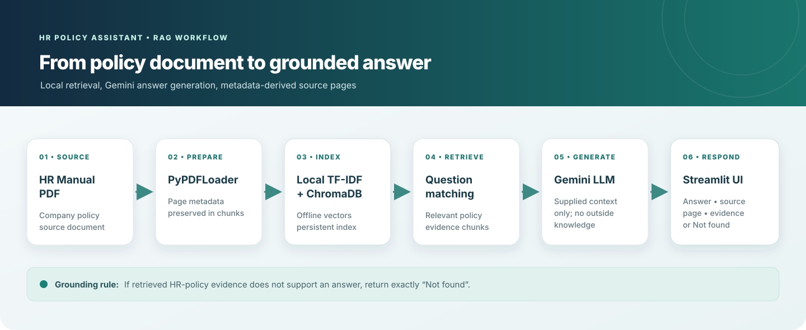
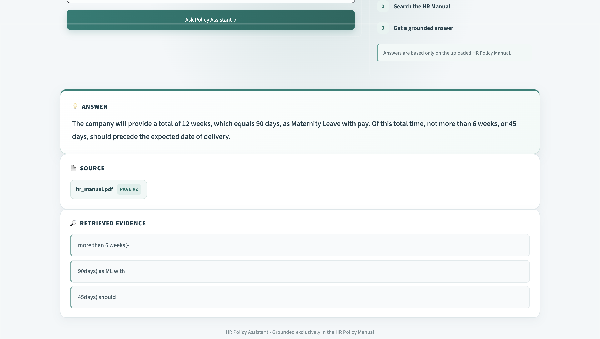

# HR Policy Assistant

A Retrieval-Augmented Generation (RAG) chatbot that answers questions using the **HR Policy Manual PDF** as its source of truth. The application is built with Python, LangChain, ChromaDB, Gemini, and Streamlit, with grounded source/page references and a strict `Not found` behavior for unsupported questions.

## Project Goal

The goal of this project is to build an HR Policy Assistant that can:

- Read and index the provided HR Policy Manual.
- Retrieve the most relevant policy content for a user's question.
- Generate answers using only the retrieved HR policy context.
- Show the source document and page number used for the answer.
- Display retrieved evidence so the answer can be verified.
- Return exactly **`Not found`** when the requested information is not supported by the HR Policy Manual.

## RAG Workflow



### Step-by-step flow

1. **HR Policy PDF**  
   The application uses `data/hr_manual.pdf` as the knowledge source.

2. **PDF loading and chunking**  
   The PDF is loaded and split into smaller document chunks. Page metadata is retained so retrieved information can be traced back to the original document.

3. **Local embeddings and ChromaDB**  
   A fitted local TF-IDF vectorizer converts chunks into vectors stored in a persistent ChromaDB collection. The vectorizer is persisted and reused for question embeddings; no Gemini embedding API is called.

4. **Question and retrieval**  
   When a user enters a question, the retriever searches ChromaDB for the most relevant policy chunks.

5. **Grounded generation**  
   The retrieved policy context is passed to the answer-generation step. The model is instructed to answer only from the retrieved HR-policy context.

6. **Answer verification in the UI**  
   Streamlit displays:
   - The grounded answer
   - Source document and page
   - Retrieved evidence

   If the document does not contain sufficient information, the assistant returns **`Not found`** instead of inventing an answer.

## Application Interface

The application is implemented in Streamlit and provides a simple question-and-answer interface.

The result area is organized into:

- **Answer** — the generated grounded response.
- **Source** — the source PDF and page number.
- **Evidence** — relevant retrieved excerpts from the policy document.

## Required Assignment Questions

### 1. Privilege Leave

**Question:**  
How many days of Privilege Leave (PL) does a permanent employee get per year?

**Expected grounded result:** 12 days  
**Source:** `hr_manual.pdf`, Page 60

### 2. Probation Period

**Question:**  
What is the probation period for employees up to Senior Manager?

**Expected grounded result:** 3 months  
**Source:** `hr_manual.pdf`, Page 42

### 3. Health-Insurance Premium

**Question:**  
What is the company's health-insurance premium amount?

**Expected result:** `Not found`

### 4. GST Rate

**Question:**  
What is the current GST rate in India?

**Expected result:** `Not found`

### 5. Maternity Leave

**Question:**  
How many days of maternity leave are given?

**Expected grounded result:** 90 days / 12 weeks  
**Source:** `hr_manual.pdf`, Page 62



> **Screenshot note:** The maternity answer screenshot was present in the project folder. Screenshots for the other four questions were not available and have not been fabricated.

## Additional Demo Questions

The assistant can also be tested with other questions related to the HR Manual, for example:

- What types of leave are available to employees?
- Who is eligible for Privilege Leave?
- What is the annual leave year period mentioned in the policy?
- What is the policy regarding maternity leave with pay?
- What is the notice period for employees?

The assistant should remain grounded in the HR Manual and should not invent information that is absent from the document.

## Technology Stack

- **Python** — application and RAG logic
- **LangChain** — document loading, retrieval, and RAG orchestration
- **ChromaDB** — persistent vector database
- **scikit-learn TF-IDF** — local/offline embeddings
- **Gemini** — answer generation only
- **PyPDF / PDF loader** — HR Manual ingestion
- **Streamlit** — web interface
- **Pytest** — automated validation

## Project Structure

```text
HR-Policy-Assistant/
│
├── data/
│   └── hr_manual.pdf (place an authorized local copy; excluded from Git)
│
├── src/
│   ├── ingest.py
│   ├── rag.py
│   └── app.py
│
├── chroma_db/
│   └── generated locally; excluded from Git
│
├── screenshots/
│   ├── rag_workflow.svg
│   └── q5_maternity_leave.png
│
├── tests/
│   └── test_hr_policy_assistant.py
│
├── app.py
├── requirements.txt
├── .env.example
├── .gitignore
└── README.md
```

The HR Manual PDF is not included because its redistribution rights are not established. Place an authorized copy at `data/hr_manual.pdf` before ingestion. The local `.env`, API keys, vector database, and generated cache files are excluded from version control.

## Running the Application

Install the required dependencies:

```bash
pip install -r requirements.txt
```

Start Streamlit:

```bash
streamlit run app.py --server.headless true --server.port 8502
```

Then open:

```text
http://localhost:8502
```

## Testing

Run the automated tests with:

```bash
python3 -m pytest -q
```

The final validation used for the submission confirms the test suite passes and the Streamlit application starts successfully.

## Grounding and Safety Behavior

The assistant is intentionally constrained to the HR Policy Manual:

- It does not use outside knowledge to answer HR-policy questions.
- Source pages come from document metadata rather than being invented by the model.
- Retrieved evidence is shown alongside supported answers.
- Unsupported questions return exactly **`Not found`**.
- Supported answers are presented as complete grounded sentences.

## Example

**Question:**  
How many days of Privilege Leave (PL) does a permanent employee get per year?

**Answer:**  
Permanent employees are eligible to avail Privilege Leave (PL) as outlined in the leave policy. Each employee is allowed 12 days of Privilege Leave calculated for a period of one calendar year.

**Source:** `hr_manual.pdf — Page 60`

**Evidence:**  
The retrieved HR policy excerpts support the 12-day entitlement and the calendar-year leave period.

## Submission Evidence

The `screenshots/rag_workflow.svg` diagram shows the PDF-to-answer workflow. The available maternity answer screenshot is included as `screenshots/q5_maternity_leave.png`. Capture screenshots for the other questions from the running Streamlit application if further visual evidence is required.

---

**HR Policy Assistant — Grounded exclusively in the HR Policy Manual**
